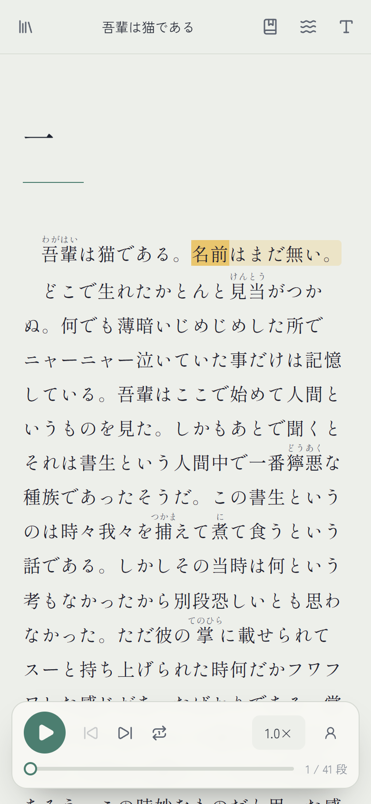

# EchoReader

日英双语有声小说阅读器：边听边读，点词即查，适合用小说学日语、英语。

*A bilingual (Japanese / English) read-along novel reader for language learners: neural TTS with word-by-word highlighting, tap-to-look-up dictionary (Chinese and English glosses), vocabulary book with Anki export, vertical Japanese text, ambient sounds, and an installable offline-capable PWA. Runs on your own computer.*


| 竖排（縦書き） | 点词查词典 | 手机 |
|---|---|---|
|  |  |  |

## 功能

- **书源**：从 小説家になろう 搜索日语网络小说，从 Project Gutenberg 搜索英文经典；字号、行高可调，记住读到哪一章
- **朗读**：微软神经网络声线（日语 Nanami / Keita，英语 Jenny / Ryan），句子与单词同步高亮；0.8× / 1.0× / 1.25×；读完自动下一章
- **查词**：点任意一个词弹出释义卡片。日语按上下文求原形（食べ → 食べる）和读音，**中文释义**（维基词典）在前、英文释义（JMdict）在后；英语查 Free Dictionary，自动还原词形
- **学习**：生词本（保存原句和出处，一键导出 Anki）；单句 0.8× 慢速跟读；可给所有汉字自动注音
- **阅读体验**：日语竖排；亮色 / OLED 纯黑 / 羊皮纸三种主题；雨夜、壁炉、咖啡馆环境音，朗读时自动压低
- **手机**：同一 Wi-Fi 直接访问；通过 HTTPS 访问时可安装到主屏幕，整本书离线下载后断网也能读

## 快速开始

需要 [Node.js](https://nodejs.org/) 22.13 或更高版本。

```bash
git clone https://github.com/Nickrockwall/echoreader.git
cd echoreader
npm install
npm start
```

浏览器打开 http://localhost:3001 。日语词典随仓库提供，首次启动会自动解压（几秒钟），不需要额外下载。

开发时用 `npm run dev`（前端 http://localhost:5173 ，改代码自动刷新）。

## 在手机上用

`npm start` 后终端会打印局域网地址（`http://192.168.x.x:3001`），手机连同一 Wi-Fi 打开即可。Windows 第一次运行时防火墙会询问，选「允许」。

要把它**安装到手机主屏幕**、**离开电脑也能离线读**，浏览器要求用 HTTPS 地址。最简单的办法是 [Tailscale](https://tailscale.com/)（个人免费）：

1. 电脑和手机都装 Tailscale，登录同一账号
2. 在电脑上运行一次 `tailscale serve --bg 3001`（按提示在网页上开启 HTTPS，设置会一直保留）
3. 手机打开 `tailscale serve status` 显示的 `https://<电脑名>.<网络名>.ts.net`，用浏览器菜单「添加到主屏幕」

Windows 上可以双击 `scripts/windows/start-hidden.vbs` 在后台运行阅读器（不弹窗口）。

## 快捷键

| 键 | 作用 |
|---|---|
| 空格 | 朗读 / 暂停 |
| ← / → | 后退 / 前进 5 秒（可跨段） |
| R | 从头重听当前句 |
| Shift + R | 以 0.8× 慢速跟读当前句 |
| ? | 显示快捷键列表 |

## 使用须知

- **个人使用**：本项目是在自己电脑上运行的阅读工具。小説家になろう 上的作品版权属于各作者，请只用于个人阅读，遵守[なろう的利用規約](https://syosetu.com/site/rule/)，不要用它公开转载作品。Project Gutenberg 的书在美国属于公有领域。
- **朗读服务**：朗读使用微软 Edge 浏览器的在线朗读接口（通过 [node-edge-tts](https://github.com/SchneeHertz/node-edge-tts)），这不是微软官方提供给第三方的服务，可能随时变化或受到限流。
- **抓取礼仪**：对 なろう 的请求限制为每秒一次，结果会缓存在本地。

## 数据与许可

- 代码：[MIT](LICENSE)
- 日语词典：JMdict（EDRDG）与中文维基词典，CC BY-SA 4.0，详见 [`server/dict-data/README.md`](server/dict-data/README.md)。想更新到最新数据可运行 `npm run setup:dict -w server`
- 咖啡馆环境音：公有领域录音，详见 [`client/public/ambient/ATTRIBUTION.md`](client/public/ambient/ATTRIBUTION.md)；雨声、壁炉声由浏览器实时合成

## 项目结构

- `server/` — Express：书源适配（`sources/`）、朗读（`tts/`）、查词与注音（`dict/`，kuromoji + SQLite）、生词本（`user/`）
  - 上游响应缓存在 `server/.cache/`，你自己的数据（生词本、离线记录）在 `server/data/`，都可随时删除
- `client/` — Vite + React 18 + Tailwind 4 + Zustand + Radix UI；朗读引擎在 `lib/speechEngine.ts`，混音在 `lib/audioGraph.ts`
- `shared/types.ts` — 前后端共用类型

文本约定：段落字符串里 `""` 表示场景分隔，注音写作 `｜漢字《かんじ》`。
